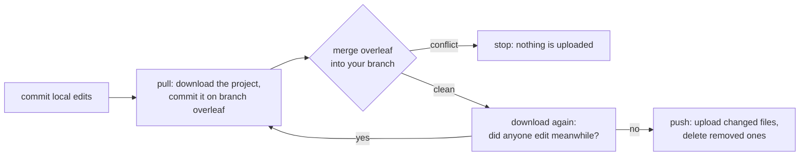

# olmerge

**Work on your Overleaf paper locally, with git, and merge with your co-authors' edits on Overleaf. On any Overleaf plan.**

Overleaf's git integration is a paid feature. `olmerge` gives you the part that matters on the free plan too: a real
git three-way merge between your local repository and the Overleaf project, in one command.

```console
$ olmerge sync
committed local edits
pulled changes from Overleaf
merged Overleaf into main
2 file(s) to push: M sections/results.tex, A figures/fig3.pdf
  uploaded sections/results.tex
  uploaded figures/fig3.pdf
pushed: Overleaf now matches 1f3c2ab
```

Write in your own editor (VS Code with LaTeX Workshop, Vim, anything) while your co-authors keep writing in the
browser. Every sync brings their changes in, merges them with yours, and sends the result back.

## How it works

`olmerge` keeps the state of the Overleaf project on a local branch called `overleaf`. A sync runs four steps:



* The merge base is always the last state both sides agreed on, so edits to different parts of the same file merge
  cleanly, exactly as with any git remote.
* **A conflict never reaches Overleaf.** `olmerge` stops, you resolve the conflict in your editor, commit, and sync
  again.
* Before uploading, `olmerge` downloads the project once more. If a co-author typed something in the meantime, it
  starts over instead of overwriting their edit.
* Only files that differ are uploaded. Folders are created as needed, and files you deleted locally are deleted on
  Overleaf.

Under the hood `olmerge` uses [pyoverleaf](https://github.com/jkulhanek/pyoverleaf), which talks to the same web
endpoints as the Overleaf editor.

## Install

```console
pip install git+https://github.com/FrancescoCorrenti/olmerge
```

Python 3.9 or later and git are required.

## Quick start

**1. Log in once.** On [overleaf.com](https://www.overleaf.com), while logged in, open the browser's developer tools
(F12), go to *Application* (Chrome, Edge) or *Storage* (Firefox), then *Cookies*, `https://www.overleaf.com`, and copy
the value of `overleaf_session2`. Then:

```console
olmerge login
```

The cookie is stored in your operating system's keychain (Windows Credential Manager, macOS Keychain, Secret Service
on Linux), never in a file. It stays valid until you log out of Overleaf. For CI, set `OVERLEAF_SESSION` instead.

**2. Bind a repository to a project.** Either create a new Overleaf project from your repository:

```console
cd my-paper
git init && git add -A && git commit -m "first draft"
olmerge create "My paper"
```

or bind an existing project (the id is the last part of its URL):

```console
olmerge bind https://www.overleaf.com/project/0123456789abcdef01234567
olmerge sync
```

**3. Sync whenever you like.**

```console
olmerge sync             # pull, merge, push
olmerge sync --dry-run   # show what would be pushed
olmerge projects         # list your projects
```

## Configuration

The binding lives in `.overleaf.json` at the top of the repository:

```json
{
 "project_id": "0123456789abcdef01234567",
 "exclude": ["notes/", "data/"],
 "host": "www.overleaf.com"
}
```

* `exclude`: paths kept local, in addition to the defaults: `.git/`, `.vscode/`, `.idea/`, `build/`, `out/`,
  `.overleaf.json`, `.gitignore`, `.gitattributes`, `latexmkrc`, `.latexmkrc` (a local `latexmkrc` often contains
  settings, like an output folder, that would break Overleaf's compiler).
* `host`: for a self-hosted Overleaf (Community or Server Pro).

`create` and `bind` also set the repository to LF line endings (`.gitattributes`, `core.autocrlf false`), because
Overleaf stores LF: otherwise on Windows every file would look modified at every sync.

### VS Code

Add a task to `.vscode/tasks.json` and run it with *Ctrl+Shift+P, Run Task*:

```json
{
  "version": "2.0.0",
  "tasks": [{ "label": "Overleaf sync", "type": "shell", "command": "olmerge sync", "problemMatcher": [] }]
}
```

## Good to know

* **Comments and tracked changes.** When `olmerge` uploads a file, Overleaf replaces that document. Comments and
  tracked changes attached to a file you edited locally are lost on Overleaf (they never existed in your local
  copy). Files you did not touch keep theirs. The previous version stays in Overleaf's history.
* **Unofficial endpoints.** Overleaf does not offer a public API for this; `olmerge` uses the endpoints of its web
  editor. If Overleaf changes them, `olmerge` may break until pyoverleaf is updated. The pyoverleaf version is pinned
  for this reason.
* **Renames** are sent as a deletion plus an addition.
* **Two people syncing at the same instant** are protected by the second download check, but not by a lock.
* Your Overleaf session cookie gives full access to your account: keep it in the keychain, never commit it.

## Development

```console
git clone https://github.com/FrancescoCorrenti/olmerge && cd olmerge
pip install -e .
python tests/test_olmerge.py   # merge logic against a fake Overleaf, no network
```

## License

MIT. Not affiliated with Overleaf.
